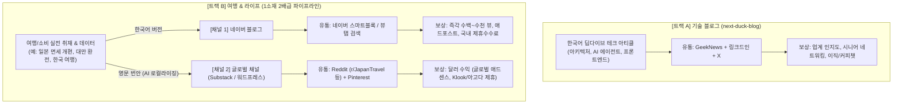

# 최종 채널 분리 및 콘텐츠 배급 전략 (3채널 파이프라인)

> **핵심 원칙**: 
> 1. "인기 없고 의미 없는 것은 하지 않는다."  
> 2. **기술 블로그는 한국어 순도 100% 집중** (시니어 브랜딩 & 네트워킹)
> 3. **여행 콘텐츠는 1소재 2배급 (네이버 블로그 + 글로벌 영문 채널)** (트래픽 & 실질 수익 극대화)

---

## 1. 3채널 포트폴리오 전체 구조

---

## 2. 채널별 상세 운영 전략

### [채널 1] next-duck-blog ➔ 한국어 시니어 기술 블로그
* **언어**: **한국어 100%** (다국어 번역 작업 전면 중단 ➔ 번역 리소스를 글의 기술적 깊이에 투자)
* **목적**: "이 사람 개발 진짜 깊게 하네"라는 업계 인정과 테크 리더십 확보.
* **주제**:
  - `architecture`: 대규모 웹 아키텍처, Next.js + AWS 인프라, 캐싱
  - `ai`: 36GB Mac Studio 로컬 LLM, Hermes Agent, Claude Hooks
  - `web`: Web Components (Lit), HLS 스트리밍, 브라우저 인터널
  - `career`: RSC 면접 의도, 8년 차 회고, 개발자 시니어 인사이트
* **유통 루틴**: 글 발행 즉시 **GeekNews 등록 + 링크드인 3줄 요약 배포**.

---

### [채널 2] 네이버 블로그 ➔ 국내 여행 & 생활 정보 (빠른 트래픽)
* **언어**: 한국어
* **목적**: 즉각적인 검색 트래픽(일 방문자 수천 명), 공감/댓글 피드백, 협찬 및 애드포스트.
* **콘텐츠 특징**:
  - 사진과 영수증, 지도 캡처 위주.
  - 검색 키워드 중심: "2026 일본 면세 환급", "대만 트래블로그 ATM 환전", "도쿄 신주쿠 숙소 추천".
* **수익화**:
  - 네이버 애드포스트
  - 쿠팡 파트너스 / 아고다 / 마이리얼트립 제휴 링크 삽입

---

### [채널 3] 글로벌 영문 여행 채널 ➔ 달러 머니 파이프라인 (Reddit & 핀터레스트)
* **언어**: **영어 (English)**
* **추천 플랫폼**:
  - **옵션 1 (초간단)**: **Substack** 또는 **Medium** (서버/도메인 세팅 0분, 링크 공유에 최적화)
  - **옵션 2 (수익 극대화)**: 별도 영문 도메인의 **워드프레스** or **정적 블로그** (구글 애드센스 탑재)
* **1소재 2배급 워크플로우 (OSMU)**:
  1. 네이버 블로그에 한국어 여행 글 작성
  2. AI(Claude/Gemini)에게 영문 번안 요청: *"외국인 배낭여행자/관광객 눈높이의 친절한 실전 가이드로 변환해줘"*
  3. 영문 채널에 발행
  4. **Reddit 배포**:
     - `r/JapanTravel`, `r/koreatravel`, `r/travel`에 핵심 팁 요약본 포스팅 후 "자세한 단계별 스크린샷은 링크 참고"로 연결.
  5. **Pinterest 배포**:
     - 면세 절차나 환전 팁을 핀터레스트 카드 이미지로 제작하여 핀 등록.
* **수익화**:
  - 미국/유럽 타깃 글로벌 애드센스 (한국 대비 RPM 5~10배)
  - Klook, GetYourGuide, Booking.com 글로벌 어필리에이트 (달러 정산)

---

## 3. 리소스 배분 및 실행 가이드

| 우선순위 | 작업 영역 | 실행 주기 |
| :---: | :--- | :--- |
| **P1** | **기술 블로그 (next-duck-blog)**: 월 1~2편의 딥다이브 아티클 작성 + GeekNews/링크드인 배포 | 2주에 1회 |
| **P2** | **네이버 블로그**: 여행/소비/호텔 경험 발생 시 가볍게 사진 위주 포스팅 | 경험 발생 시 즉시 |
| **P3** | **글로벌 영문 배급**: 네이버 글 중 외국인에게도 유용한 꿀팁을 AI 번역 ➔ 레딧/핀터레스트 배포 | 월 1회 (우수 소재만) |
